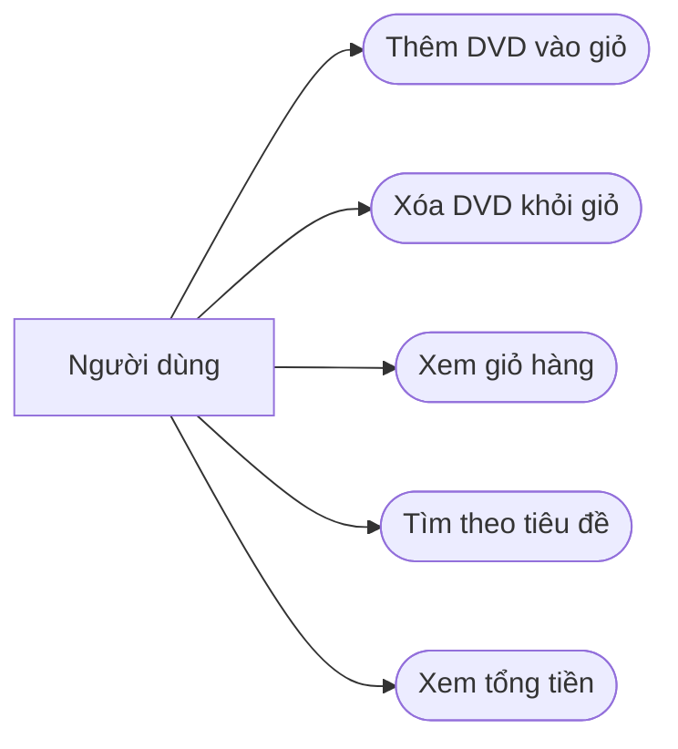

# Use case AIMS-mini

## Xem giỏ hàng

- Tác nhân: người dùng ứng dụng mẫu.
- Tiền điều kiện: đã tạo Cart; có thể chưa có DVD.
- Luồng chính: gọi print_cart → hiển thị DVD theo thứ tự → tổng tiền.
- Ngoại lệ: giỏ trống hiển thị `The cart is empty`.
- Hậu điều kiện: giỏ hàng không thay đổi.

## Tìm theo tiêu đề

- Đầu vào: danh sách DVD và từ khóa.
- Đầu ra: danh sách các DVD có tiêu đề chứa từ khóa; không đổi dữ liệu gốc.
- Không có kết quả: trả danh sách rỗng.
- Lab 02 dùng so khớp phân biệt hoa thường; Lab 05 cập nhật đặc tả và hotfix.
